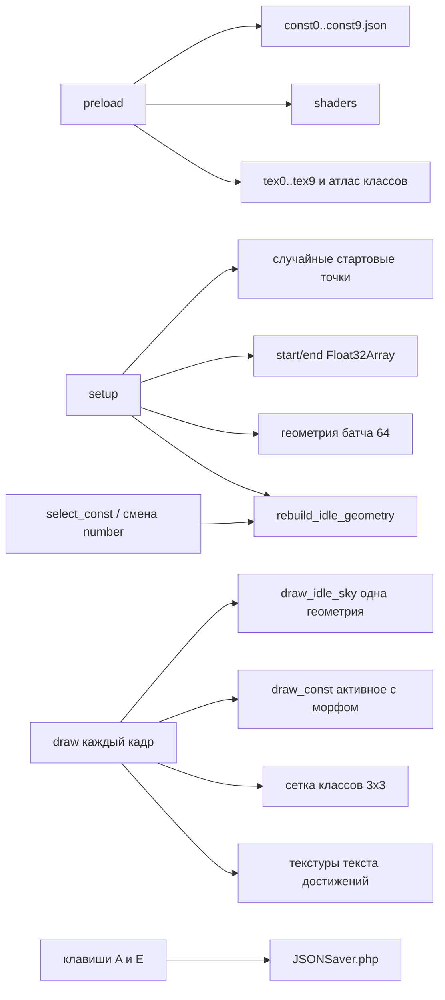

# Архитектура

Описание текущего устройства доски. Для предложений по замене см. [optimization.md](optimization.md).

## Стек

- **Клиент:** p5.js 1.9.4, режим `WEBGL`, шейдеры GLSL ES 3.00 (`#version 300 es`).
- **Данные:** статические JSON и PNG в `assets/`.
- **Редактор:** та же сцена + [`assets/js/add_new_star.js`](../assets/js/add_new_star.js).
- **Сохранение:** [`JSONSaver.php`](../JSONSaver.php) — `POST` JSON `{ name, obj }` → файл `assets/json/{name}.json`.

Точка входа доски — [`index.html`](../index.html). Скрипты подключаются в порядке: `options.js` → `svg_parser.js` → `make_a_texture.js` → `interface_handler.js` → `main.js`.

## Роли модулей

| Файл | Роль |
| --- | --- |
| [`main.js`](../assets/js/main.js) | `preload` / `setup` / `draw`, колесо, мышь, клавиши, `windowResized` |
| [`options.js`](../assets/js/options.js) | Класс `dataHandler`: пути, загрузка, масштаб, анимация, отрисовка, hit-test |
| [`make_a_texture.js`](../assets/js/make_a_texture.js) | `smth(x) = 1 - (1-x)³` (easing морфа и карточек); `makeTextureAnim` больше не в горячем пути |
| [`svg_parser.js`](../assets/js/svg_parser.js) | Офлайн-генератор вершин из SVG; **не** вызывается при старте доски |
| [`add_new_star.js`](../assets/js/add_new_star.js) | `add_new_star` / `delete_star` / `SaveConstOnServer` (только на странице редактора) |
| [`interface_handler.js`](../assets/js/interface_handler.js) | Старые `mouseHandler` / `displayText`; основной ввод живёт в `dataHandler` |

Почти вся логика сосредоточена в `dataHandler` (~700 строк): один объект отвечает за данные, UI и GPU.

## Жизненный цикл

### preload

1. `new dataHandler()`, `set_count(10)`.
2. Загрузка шести пар шейдеров (`img`, `bg`, `text`, `star`, `class`, `class_selected`).
3. Текстуры созвездий, звезда, атлас классов; шрифт `ARIALI.TTF`.
4. Каждый JSON — **один** `loadJSON` в `origN` (p5 заполняет объект до `setup`).

### setup

1. `createCanvas` + `pixelDensity(1)`, `DEPTH_TEST` выключен.
2. `d.setup`: clone `orig` → `vert`, масштаб, случайные точки россыпи; геометрия батча (64 квада); `notify_stars_changed` → `start_data` / `end_data` и `rebuild_idle_geometry` (все россыпи кроме активного, с lit/dim по `number`); три framebuffer для карточек.

### draw (каждый кадр)

1. `draw_background` — туманность (domain-warp fBm) в framebuffer с редким обновлением, на экран — блит текстуры; панель настроек по `N`.
2. Если `current_constallation < 9` — `draw_achivements`.
3. `draw_idle_sky` — одна запечённая геометрия неактивных (`uMode=0`); `draw_const` — морф активного (`pos[64]`, `uMode=1`).
4. `draw_class` — сетка 3×3 и подсветка.
5. `draw_background_const` — PNG-силуэт текущего созвездия.
6. `transition_decider` — сжатие → выбор нового класса.

## Модель сцены

### Созвездие

- Цель: массив вершин `vert` в нормализованных координатах примерно `[-1, 1]`.
- Старт морфа: случайные точки в том же пространстве.
- Рендер: p5-геометрия из квадов; в вершинном шейдере позиция квада берётся из `uniform vec2 pos[vID]`, где `vID = gl_VertexID / 4`.
- Состояния звезды в шейдере: «пустая» (меньше), «зажжённая» (`vID <= last_lit`), «активная» (`vID == act`) — разные срезы атласа `star_texture.png`.

### Домашний экран (индекс 9)

- Стартовое значение `star_animation.current_constallation = 9`.
- Силуэт и надпись года живут в `tex9.png`, не в данных.
- Панель достижений не рисуется (`current < 9`).
- В сетке 3×3 клетки только для 0–8; индекс 9 кликом не выбирается.
- После перехода на класс звёзды «лицея» возвращаются в россыпь и становятся частью неба.

### Небо

Не отдельный фон, а **одна пересобираемая геометрия** idle-россыпей (`rebuild_idle_geometry` / `draw_idle_sky`):

- В mesh попадают все классы, кроме `current_constallation`.
- Для звезды `j` класса: lit-размер и UV атласа, если `j < number`, иначе dim — прогресс на небе сохраняется.
- Пересборка при `setup`, `update_all` / `notify_stars_changed` (в т.ч. после `add_new_star` / `delete_star`), и в `select_const`.
- Пока класс активен, он только в морфе; в конце сжатия морф на россыпи (`t=0`), затем idle подхватывает те же `start_data` — без skip-прыжка.

### Карточки достижений

- Три (плюс служебный) `Framebuffer`: текст рисуется через `text()` p5, потом квад с шейдером `text`.
- Прокрутка: `current_achivement` + накопленный `delta` от колеса; сглаживание в `achivements_scroll_decider`.
- Переиспользование буферов через `framebuffer_update_desider` (циклический сдвиг / перерисовка).

### Сетка классов

Атлас `class_texture.png` (3×3). Позиция в нормированных координатах задаётся `class_options`. Hit-test мыши переводит пиксели в индекс 0–8. Подсветка — отдельный шейдер `class_selected`.

## Шейдеры

| Пара | Назначение |
| --- | --- |
| `bg.*` | Плоский цветной квад (утилитарные прямоугольники; запасной фон) |
| `nebula.*` / `nebula_blit.*` | Туманность fBm в offscreen-буфер и блит на экран |
| `img.*` | Силуэт созвездия; альфа/яркость от `t` (прогресс анимации) |
| `star.*` | `uMode=0`: idle-mesh (`aPosition`/`aTexCoord`); `uMode=1`: батчи `pos[64]` + `batchBase`/`batchSize`; размер/атлас от `r`, `act`, `last_lit` |
| `text.*` | Карточка из framebuffer с текстом |
| `class.*` / `class_selected.*` | Сетка классов и жёлтая подсветка клетки |

Ключевые детали после уровня 1 и idle-batching:

- Нет `pos[518]`: активное созвездие — чанки по 64; lerp start→end с `smth`.
- Idle-небо — один `model(idle_geometry)` с `uMode=0`, без покадрового цикла по классам и без skip-диапазона.
- В [`star.frag`](../assets/shaders/star.frag) `myColor` инициализирован.

## Ввод

| Событие | Условие | Действие |
| --- | --- | --- |
| `mouseMoved` | анимация собрана (`finished == 1`) | hit-test сетки и звёзд; наведение на звезду крутит карточку |
| `mouseClicked` | есть `current_selection` | `unselect_const` + `transition = selection` |
| `mouseWheel` | анимация собрана | `wheel_handler` — сдвиг списка достижений |
| `keyPressed` `A` / `E` | определена `add_new_star` (страница редактора) | добавить/править или удалить звезду |
| `windowResized` | всегда | `resizeCanvas` + `update_all` (пересчёт масштаба и анимаций) |

Переход между классами всегда двухфазный: текущее созвездие сжимается (`direction = -1`), затем новое раскрывается (`select_const`).

## Редактор и сохранение

Страница [`add_new_star.html`](../add_new_star.html) подключает те же скрипты плюс `add_new_star.js`.

- **A** — prompt заголовка и текста; если индекс уже «зажжён» — правка; иначе `number++` и swap на место.
- **E** — пометка `DELETED` / уменьшение `number` и swap.
- Запись: `fetch("JSONSaver.php", { body: JSON.stringify({ name, obj }) })`.

Риски [`JSONSaver.php`](../JSONSaver.php):

- нет авторизации;
- имя файла берётся от клиента (`$data->{"name"}`);
- запись прямо в `assets/json/`.

## Масштаб и координаты

- `scale_screen_w` / `scale_screen_h` зависят от соотношения сторон (в коде есть TODO по вертикальному режиму).
- Целевые координаты из JSON дополнительно сдвигаются: `((x+1)*0.65 - 0.3) * scale_w` по X, `y * scale_h` по Y — чтобы фигура сидела справа от карточек.
- Screen-space копии (`vert_screen_space`) используются для hit-test мыши (с учётом `height - mouseY` в WEBGL).

## Известные несостыковки

1. **9 клеток / 10 созвездий** — домашнее (9) вне сетки; после ухода его звёзды остаются в россыпи.
2. **`number: 0` во всех JSON** — в репозитории нет именованных достижений; зажжённых звёзд нет, пока их не добавят редактором или вручную.
3. **Достижение = первые N вершин** — порядок обхода SVG, не осознанный выбор точек по фигуре.
4. **Год и подписи классов в PNG** — смена учебного года / состава классов требует перерисовки текстур и правки логики сетки 3×3.

Исправлено в уровне 1: двойная загрузка JSON, `svgAnalizer` в рантайме, утечка framebuffer при ресайзе, `pos[518]`, неинициализированный `myColor`, Windows-пути.

## Замер производительности

До уровня 1 (исторический): ~14 `drawElements`/кадр, ~4000 float в `uniform2fv`, `pos[518]` с динамическим индексом.

После уровня 1 (класс выбран, холст ~1611×1274, `pixelDensity(1)`):

| Метрика | Значение |
| --- | --- |
| p5 `frameRate` | ~55–80 |
| `drawElements` / кадр | ~3–4 |
| float в `uniform2fv` / кадр | ~90 |

Дальнейшие шаги (данные v2, HTML-карточки, редактор) — в [optimization.md](optimization.md).
