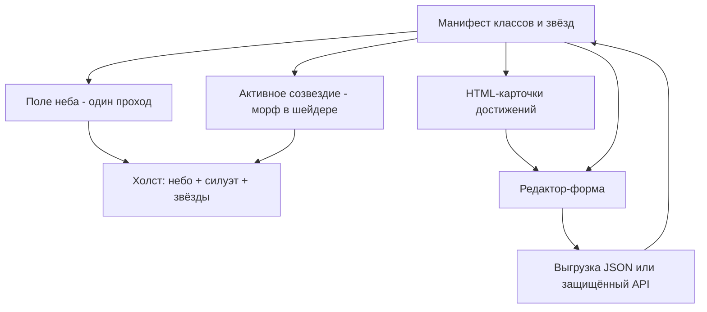

# Оптимизация и развитие

Идея продукта не меняется: **классы — созвездия, достижения — именованные звёзды**. Меняется то, как это считается и рисуется.

Связанные документы: [architecture.md](architecture.md) (как сейчас), [data-model.md](data-model.md) (данные), [README.md](README.md) (запуск).

## Контракт для зрителя

Любая оптимизация или замена движка должна сохранить:

1. Старт с домашнего экрана (контур лицея / «школьный зодиак»).
2. Выбор класса → текущая фигура сжимается в россыпь → новая собирается.
3. Зажжённые звёзды заметнее; выбранная — самая яркая.
4. У зажжённой звезды — имя и текст достижения (карточка / панель).
5. Небо из точек остаётся частью атмосферы (даже если рисуется иначе).

## Почему «простая» картинка может тормозить

На быстром WebGL сцена держит ~55 FPS при GPU 0.2–0.6 мс/кадр. На части школьных ПК та же логика тяжёлая, потому что дорого не «много пикселей звезды», а **устройство кадра**:

| Фактор | Что происходит |
| --- | --- |
| Динамический индекс в `uniform vec2 pos[518]` | На каждую вершину квада — обращение `pos[vID]` в вершинном шейдере. На части Intel-драйверов это разворачивается в огромный шейдер. |
| ~4000 float / кадр через `uniform2fv` | Позиции всех звёзд всех 10 созвездий уходят на GPU каждый кадр, даже в простое. |
| Небо = 10 полных геометрий | ~2034 квада всегда; «фон» — это разбросанные созвездия. |
| MSAA 4x + `pixelDensity` | При масштабе Windows 150% / Retina буфер в 2–4 раза больше; depth/stencil запрошены, хотя depth-тест выключен. |
| Текст в framebuffer | При прокрутке достижений — повторный `text()` в offscreen-буферы. |
| p5 WEBGL | Полноэкранные квады через `rect`/`model`, обёртка `setUniform`, лишний каркас для этой 2D-сцены. |

Итого: оптимизировать нужно путь **вершины → uniform → draw всех созвездий**, а не «упрощать картинку ради FPS».

---

## Уровень 1 — точечные правки (остаёмся на p5) — реализовано

Цель: быстро снять очевидный вес и баги, не меняя визуальный язык. **Статус: сделано** (см. код и замер ниже).

| # | Изменение | Статус |
| --- | --- | --- |
| 1 | Убрать `svgAnalizer` из `setup` | сделано |
| 2 | Один `loadJSON` на файл; `vert` = clone в `setup` после preload | сделано |
| 3 | `update_all` пересоздаёт framebuffer 0..2, без `push` | сделано |
| 4 | Убран `pos[518]` и 80 предрасчитанных кадров; морф батчами `pos[64]` + lerp на CPU (`smth`) | сделано (вместо float-текстур — надёжнее с p5) |
| 5 | `pixelDensity(1)` | сделано |
| 6 | Небо = idle-созвездия с `last_lit` (не skip-слой во время морфа) | сделано |
| 7 | `myColor` инициализирован в `star.frag` | сделано |
| 8 | POSIX-пути `assets/...` | сделано |
| 9 | Idle-небо = одна пересобираемая геометрия (`rebuild_idle_geometry` / `draw_idle_sky`, `uMode=0`); активное — морф `pos[64]` | сделано |

### Замер idle-batching (CPU throttle 6×)

Узкое место после уровня 1 (идентичное небо, покадровый idle по классам): ~31 батч `setUniform`/`model` на idle каждый кадр, `drawElements` ~16/sample.

После одной idle-геометрии (тот же throttle 6×, settled class):

| Метрика | До (idle-цикл) | После (`draw_idle_sky`) |
| --- | --- | --- |
| Idle draw / кадр | ~31 батчей | 1 `model` |
| `drawElements` / кадр | ~16 | ~3.7 |
| `draw_idle_sky` / idle path | ~2 ms JS (доминировал кадр) | ~0.3 ms |
| FPS | ~55 (без throttle был ок; с 6× idle давил) | ~55 при 6× |

Идентичность и lit сохранены: в idle-mesh запекаются lit/dim по `number`; активный класс не в mesh; `select_const` / смена `number` пересобирают геометрию без skip-прыжка.

---

## Уровень 2 — рекомендуемая замена внутренностей

Цель: оставить идею и UX, сделать код и данные пригодными для сопровождения школой несколько лет.

### Данные

- Перейти на манифест из [data-model.md](data-model.md): достижение привязано к **конкретной** точке (`id` + `x,y`), не к «первым N» вершинам.
- Метаданные класса (`label`, `gridIndex`, год) — в данных, не только в PNG.

### Рендер звёзд

- Один проход: буфер вершин или текстура координат (`RG32F` / атрибуты), морф в шейдере.
- Без p5-`buildGeometry` на каждую звезду и без гигантского `uniform` массива.
- Активное созвездие + отдельное поле неба (статичное или слабо анимированное).

### UI

- Карточки достижений — **HTML/CSS** рядом с холстом (шрифт, прокрутка, доступность, копирование текста).
- Холст только: небо, силуэт, звёзды, (опционально) подсветка.
- Сетка классов может остаться на холсте или тоже уйти в DOM — на выбор; важнее отделить текст.

### Домашний режим

- Явный `home` в манифесте.
- В простое: контур лицея + дешёвое небо, без десяти полных созвездий каждый кадр.

### Редактор

- Форма (имя, текст, выбор точки на фигуре), не цепочка `prompt`.
- Запись: либо выгрузка JSON для статической выкладки (без PHP), либо бэкенд с авторизацией и whitelist имён файлов.
- Текущий `JSONSaver.php` без проверки имени — не оставлять как есть на публичном хостинге.

Оценка: существенный рефакторинг (недели). Внешний вид можно сохранить близким к текущему; внутренняя структура — новая.

---

## Уровень 3 — смена движка

Имеет смысл, если после уровня 2 p5 всё ещё мешает (размер бандла, странности WEBGL, сложность инстансинга).

| Вариант | Когда |
| --- | --- |
| Небольшой **WebGL2** без p5 | Нужен полный контроль над буферами, инстансами, одним draw call на звёзды |
| **Canvas 2D** | На экране одно созвездие порядка сотен точек, без сложных шейдеров; проще отладка |
| Готовый движок (Three.js и т.п.) | Обычно избыточен для этой 2D-сцены |

p5 здесь в основном даёт: загрузку ассетов, цикл кадра, `text()` в framebuffer и удобные `setUniform`. Для доски достижений это можно заменить тонким слоем без потери идеи созвездий.

---

## Рекомендуемый целевой контур

Зритель по-прежнему видит зодиак; разработчик работает с понятными данными и предсказуемым кадром.

---

## Порядок миграции

Не ломать всё сразу. Рекомендуемая последовательность:

### Этап A — данные и контракт

1. Зафиксировать схему v2 ([data-model.md](data-model.md)).
2. Скрипт миграции `const0…9.json` → манифест (или набор файлов классов).
3. Загрузчик на клиенте: сначала v2, при отсутствии — v1.

*Критерий готовности:* доска читает новый формат и рисует как раньше (даже на старом рендере).

### Этап B — HTML-карточки

1. Вынести имя/текст в DOM.
2. Синхронизировать выбранную звезду (клик / колесо) с панелью.
3. Убрать зависимость кадра от перерисовки text-framebuffer при скролле.

*Критерий:* прокрутка достижений не трогает GPU-текст; вёрстка читаема на проекторе.

### Этап C — небо и морф

1. ~~Отделить поле неба от «всех созвездий каждый кадр»~~ — idle-mesh + активный морф (уровень 1.9).
2. ~~Заменить `pos[518]` + 80 кадров~~ — батчи `pos[64]` + CPU lerp; дальше по желанию атрибуты + `uT` без p5-обёртки.
3. Замерить FPS на слабом ПК / встроенной графике (throttle 6× уже ок по idle).

*Критерий:* домашняя сцена и переключение класса стабильно ≥ 30 FPS на целевом железе школы.

### Этап D — редактор и сохранение

1. Форма вместо `prompt`.
2. Выбор точки на силуэте для нового достижения.
3. Безопасная запись или ручная выкладка JSON.

*Критерий:* педагог может добавить звезду без консоли и без дыры в PHP.

### Этап E — опционально WebGL2 / отказ от p5

Только если этапы A–C сделаны и профилирование всё ещё указывает на обёртку p5.

---

## Чеклист проверки после изменений

- [ ] Старт: домашний экран, сетка классов видна.
- [ ] Клик по классу: анимация сжатия/сборки, силуэт проявляется.
- [ ] Зажжённые звёзды отличаются; клик/наведение меняет карточку.
- [ ] Колесо листает достижения в разумных границах.
- [ ] Ресайз окна не роняет FPS и не течёт по памяти (framebuffer).
- [ ] На машине с интегрированной GPU — замер `frameRate` / GPU time до и после.
- [ ] Редактор: добавить, править, удалить; файл на диске валиден по схеме.

## Что сознательно не оптимизировать «в ноль»

- Художественная плотность силуэтов (сотни узлов у сложной фигуры) — это контент. Упрощать SVG можно вручную как дизайн, не как обязательный шаг кода.
- Полный отказ от анимации морфа — ломает узнаваемость продукта.
- Удаление «лишних» точек неба без замены полем — сцена станет пустой.

---

## Краткие приоритеты на ближайшую сессию разработки

1. ~~Уровень 1 + idle-batching (морф без `pos[518]`, одно idle-mesh)~~ — готово.
2. Схема данных v2 + привязка достижения к точке (этап A).
3. HTML-карточки (этап B).
4. Безопасный редактор (этап D).
